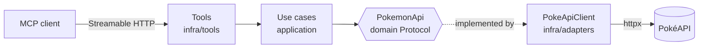

<div align="center">


**A Python MCP server that exposes the Pokémon universe as structured, read-only tools.**

[](https://www.python.org/)
[](https://py.sdk.modelcontextprotocol.io/)
[](https://modelcontextprotocol.io/)
[](https://pokeapi.co/)

[Tools](#-tools) · [Quick start](#-quick-start) · [Inspector](#-run-with-mcp-inspector) · [Architecture](#-architecture) · [Spec](docs/SPEC.md)

</div>

---

## ✨ Overview

Built on the official [MCP Python SDK](https://py.sdk.modelcontextprotocol.io/), served over **Streamable HTTP** with Uvicorn and backed by [PokéAPI v2](https://pokeapi.co/).

- 🧱 **Clean architecture** — tool → use case → domain Protocol → adapter → API
- ⚙️ **Centralized config** — Pydantic `BaseSettings` + `.env`
- 📜 **Spec-driven** — behavior defined in [docs/SPEC.md](docs/SPEC.md)
- 🛡️ **Guardrailed** — strict input schemas, untrusted-data delimiting, URL allowlists, output DLP, decision audit (see [Guardrails](docs/SPEC.md#guardrails))
- 🔎 **Structured JSON logs** on stderr, correlated by `request_id`
- 🧪 **Tested** — use cases with fakes, HTTP adapter with mocked transport

## 🧰 Tools

All tools are read-only and return structured output.

| Category | Tool | Description |
|---|---|---|
| ❤️ Health | `health_check` | Server liveness |
| 🐾 Pokémon | `get_pokemon_details` | Types, abilities, base stats, sprite |
| | `get_pokemon_species` | Color, habitat, generation, legendary flags, flavor text |
| | `get_pokemon_evolution` | Nested evolution chain |
| | `get_pokemon_encounters` | Locations and versions where a Pokémon appears |
| 📚 Reference | `get_type_matchups` | Type damage relations |
| | `get_move_details` | Type, power, accuracy, PP, effect |
| | `get_ability_details` | Effect and Pokémon that have it |
| | `get_item_details` | Category, cost, effect |
| 📄 Lists | `list_pokemon` · `list_moves` · `list_abilities` · `list_items` | Paginated (`limit` 1–100, `offset` ≥ 0) with `next_offset` / `previous_offset` |

Errors carry a stable code, e.g. `[pokemon_not_found]`, `[invalid_pokemon_identifier]`, `[pokemon_api_unavailable]`.

## 🚀 Quick start

**Requirements:** Python 3.11+ · Node.js 18+ (only for Inspector)

```powershell
python -m venv .venv
.\.venv\Scripts\python -m pip install -r app\requirements.txt   # runtime only
# or: .\.venv\Scripts\python -m pip install -r requirements-dev.txt  # runtime + tests
Copy-Item .env.example .env   # optional; defaults work without it
.\.venv\Scripts\python app\run.py
```

The server logs JSON lines on stderr and listens at **`http://127.0.0.1:8000/mcp`**.

> [!NOTE]
> Run it as `python app\run.py` from the project root. The launcher removes `app/` from `sys.path` so `app/mcp` does not shadow the installed `mcp` SDK.

### Configuration

Set via environment variables or `.env` (loaded by `Settings` in `app/mcp/application/configuration/settings.py`):

| Variable | Default | Description |
|---|---|---|
| `MCP_HOST` | `127.0.0.1` | Bind host |
| `MCP_PORT` | `8000` | Bind port |
| `MCP_RELOAD` | `false` | Uvicorn auto-reload |
| `POKEAPI_BASE_URL` | `https://pokeapi.co/api/v2` | PokéAPI base URL |
| `POKEAPI_TIMEOUT` | `10.0` | HTTP timeout (seconds) |

## 🔍 Run with MCP Inspector

1. Start the server (see above) and keep it running.
2. In a second terminal:

   ```powershell
   npx --yes @modelcontextprotocol/inspector@latest --transport http --server-url http://127.0.0.1:8000/mcp
   ```

3. Open the URL it prints (`http://127.0.0.1:6274?MCP_INSPECTOR_API_TOKEN=...`). The token is required.
4. Confirm transport **HTTP** and URL `http://127.0.0.1:8000/mcp`, then click **Connect**.
5. Go to **Tools** → **List Tools**, pick one (e.g. `get_pokemon_details` with `pokemon = pikachu`) and **Run Tool**.

> [!TIP]
> The Logging capability shows as disabled by design. Logs go to the server's stderr as JSON.

Stop both processes with `Ctrl+C` (Inspector uses ports 6274/6275).

### Without Inspector

Streamable HTTP is stateful: `initialize` → `notifications/initialized` → `tools/call`, sending the `mcp-session-id` header returned by `initialize`. On PowerShell, write each JSON request body to a file and use `curl.exe --data-binary "@file"`; include the returned `mcp-session-id` header on follow-up requests.

## 🏗️ Architecture



```text
app/
├── run.py                      # launcher (uvicorn)
└── mcp/
    ├── application/            # settings, use cases, guardrails (text/URL/DLP)
    ├── domain/                 # exceptions, Identity, PokemonApi Protocol
    └── infra/                  # adapter, tools/registry, entrypoint, JSON logging
docs/SPEC.md                    # tool specification (incl. guardrail pipeline)
tests/                          # pytest suite
```

### Guardrails

This server doubles as a study skeleton for the MCP guardrail pipeline (authentication is intentionally out of scope). Every tool call passes:

1. **Input guard** — strict schema at the protocol boundary (`maxLength`, ranges), then normalization (Unicode NFKC, zero-width stripping) before re-validation in the use case.
2. **Output guard** — allowlist DTOs only; provider free text is truncated and wrapped in `<pokeapi_data>…</pokeapi_data>` (untrusted data, never instructions); sprite URLs require an allowlisted HTTPS host; nested collections are capped.
3. **Output DLP + audit** — serialized results are scanned for Luhn-valid PANs, credential patterns, and high-entropy strings (block) and valid CPF numbers (redact); evasion via separators/zero-width characters also blocks. Failures fail closed. Each decision is logged to the `guardrails.audit` logger with `request_id` and a simulated `sub` (from the `x-study-user` header — a placeholder showing where token-derived identity plugs in, **not** authentication).

## 🧪 Tests

```powershell
.\.venv\Scripts\python -m pytest
```

## 📄 Attribution

Data from [PokéAPI](https://pokeapi.co/). Pokémon and Pokémon character names are trademarks of Nintendo, Game Freak and Creatures Inc. This project is not affiliated with or endorsed by them.
